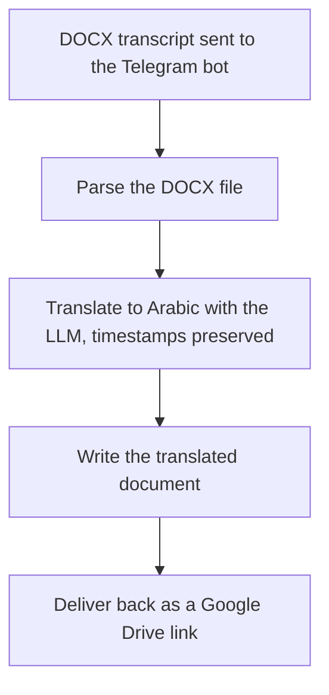

# Transcript Translator Bot

A paid freelance delivery that turns a DOCX transcript into an Arabic translation with every timestamp preserved, delivered back as a Google Drive link.

**[Watch the demo](https://youtu.be/UNfAMzjIiEE)**

## The problem

Translating long transcripts by hand is slow and easy to get wrong, and the timestamps that make a transcript useful are the first thing lost in the process. Teams that need Arabic versions of their transcripts spend hours per file on work that takes no judgment, only time.

## What it does

- Receives DOCX transcript files through a Telegram bot
- Translates the content to Arabic with an LLM while preserving all timestamps and structure
- Writes the translated document and delivers it back as a Drive link
- Replaces hours of manual translation work per file

## Architecture

## Stack

n8n, Telegram Bot API, GPT-4o-mini, Google Drive.

## Workflow

- `transcript-translator.json`: the full pipeline, covering Telegram intake, DOCX parsing, timestamped translation, and Drive delivery.

## Import and setup

1. Import the JSON into n8n.
2. Create credentials: Telegram bot token, OpenAI (or your LLM provider), Google Drive. Credential references are name-only placeholders.

## Note on redaction

All credentials, webhook IDs, and Drive links have been replaced with self-describing placeholders. The workflow logic is exactly what was delivered.

## License

Released under the MIT License. See [LICENSE](LICENSE).

---

Built by [Moamen Elsharkawy](https://www.linkedin.com/in/moamen--elsharkawy/), AI Automation Engineer. More builds: [portfolio](https://www.notion.so/Moamen-Elsharkawy-AI-Automation-Specialist-c201df9dd81482998591011f978b1bda) | [GitHub profile](https://github.com/Moamen-Elsharkawy)
